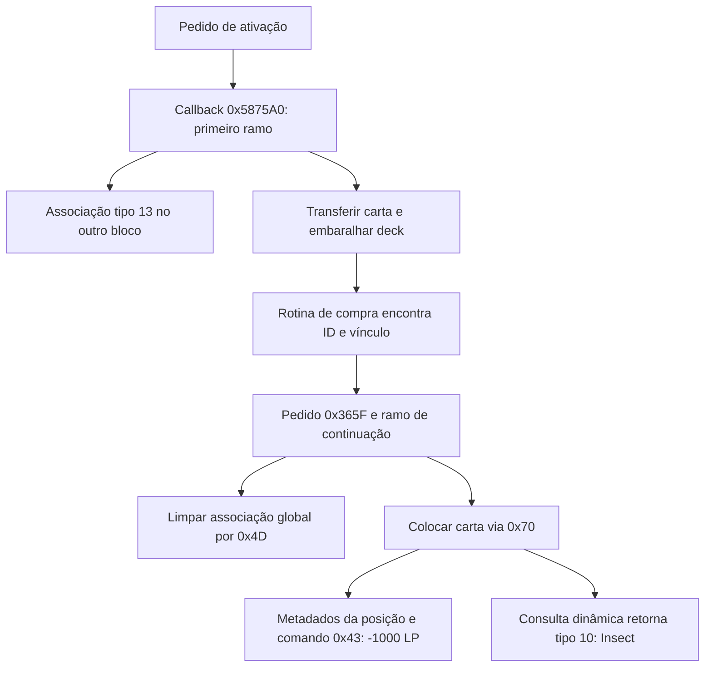

# Parasite Paracide — análise funcional estática

Consolidado em 2026-10-29. ID de recurso **762 / 0x2FA**, índice de propriedades
**197**, nome confirmado na tabela inglesa. Alvo SHA256:
`DB8FE7B7EA4B12F18A9BB1777B5F5B8EAB254011DB2A52571A0264725505B6DE`.
Endereços são VA, base `0x00400000`. Originais e banco preservados.

O fluxo funcional da carta foi reconstruído estaticamente: ativação,
transferência/embaralhamento, interceptação da compra, colocação, perda de
LP, mudança dinâmica de tipo e limpeza da associação. Não foi executado o
jogo. Essa conclusão não equivale à validação de todas as interações possíveis
com outras cartas ou de cada ramo genérico de rede, IA e apresentação.

## Comportamento e evidências independentes

O texto inglês fornecido pelo próprio jogo declara o seguinte comportamento:
FLIP coloca a carta virada para cima no deck adversário e embaralha; ao ser
comprada, ela é invocada em defesa no campo adversário, causa 1000 de dano
direto e faz os monstros adversários virados para cima serem tratados como
Insect enquanto ela permanecer virada para cima no campo.

A descrição vem de `CARD_Indxeng[197] = 22170`, usado como offset em
`CARD_Desceng`. O acessor 0x004022B0 já documentado implementa precisamente
offset uint32 por índice. Quatro recursos limitados foram decodificados
somente em memória; a descrição de uma carta e exemplos de classe foram
registrados, sem exportar os payloads completos.
[Texto e amostras](../evidence/parasite-class10-samples.json).

O texto permite nomear os comportamentos; os acessos e comandos abaixo são
comprovação separada no código, não inferências baseadas apenas nessa descrição.



As operações são enfileiradas e executadas por máquinas de estados; as
setas representam dependências funcionais, não execução síncrona numa função.

## 1. Seleção da carta e ativação

0x0059DBE0 converte índice→ID e busca registros de 24 bytes em 0x005ED0A8.
O registro 150, VA **0x005EDEB8**, contém:

| Campo | Valor | Papel comprovado |
|---|---|---|
| +0 | 762 | ID da carta |
| +4 | 0x005875A0 | Callback principal via 0x0059DEB0 |
| +8 | zero | Callback adicional ausente nesse registro |
| +12 | 0x005800A0 | Validação via 0x0059DD90 |
| +16 | 0x0057CCC0 | Limpeza/preparação via 0x0059DE30 |
| +20 | zero | Outro slot ausente; não usado neste caso |

O callback de validação retorna falso quando o pedido é do ramo inicial e a
posição indicada está vazia; o ramo 0x2000 é admitido por esse callback.
Isso não elimina as demais condições genéricas da ativação em 0x0057EAC0.

A máquina 0x00597E90, caso 11/regiões 0 ou 5, emite 0x91 quando o bit de
face não estava definido e monta o pedido em 0x005BA4D0 com a chave da palavra
de estado. O código montado nesse caminho não seleciona o discriminante
0x2000. O primeiro ramo de 0x005875A0 confirma índice e bit de face da posição
antes de inserir a associação. Isso liga o produtor inicial ao ramo correto;
o texto FLIP do recurso confirma a semântica do caso de virar a carta.

Evidências: [registro](../evidence/parasite-handler-registration.txt),
[busca](../evidence/card-handler-id-search.txt),
[validação/limpeza](../evidence/parasite-damage-and-callbacks.txt),
[roteamento](../evidence/parasite-postcallback-and-value-write.txt),
[produtores de pedido](../evidence/parasite-initial-request-path.txt),
[evento inicial](../evidence/parasite-event-dispatch.txt).

## 2. Associação, transferência e embaralhamento

O pedido tem 20 bytes. Seus bits 5–12 em +4 guardam a chave `k`.
O primeiro ramo chama **0x00579790(1-s, indice, 13 | k<<8)**. O comando
0x86 grava o índice e metadados no fim da categoria 11 do outro bloco:

```text
contador: 0x00A563AE + bloco*0xD44
índices:  0x00A563B0 + bloco*0xD44 + posição*2
metadados:0x00A563F0 + bloco*0xD44 + posição*2
```

0x00577AC0 passa a máscara da posição para 0x00576960, com destino/região 13
e flag que permite trocar o bloco de destino. 0x00576B30 emite a transferência
0x8F; 0x00409240 remove a origem por 0x00570790 e insere o destino por
0x005708D0. Região 13 é a sequência baseada em **0x00A56574**, inicialmente
preenchida pelos índices do deck em 0x00569380.

O callback emite também 0x60 para o outro bloco. Seu consumidor 0x00408B90
semeia o gerador e chama **0x00568D80(bloco,3)**, que troca posições aleatórias
da sequência 0x00A56574. Há outra estratégia de permutação para versões/modos
comparados com 1000; ambas foram identificadas como embaralhamento pelos acessos.

Evidências: [transferência inicial](../evidence/parasite-initial-transfer.txt),
[remoção/inserção e embaralhamento](../evidence/parasite-shuffle-transfer.txt),
[seletor de regiões e algoritmo de permutação](../evidence/parasite-placement-driver.txt).

## 3. Compra e continuação

0x00578860 percorre entradas da sequência do deck e distingue ID 762 com
associação válida. A busca **0x00570BE0** exige índice de Parasite, nibble 13
e byte de vínculo igual a:

```text
k = ((palavra >> 12) & 1) + 2*((palavra >> 24) & 127)
```

No caminho especial, emite pedido `0x365F0000 | índice | bloco<<31`, passando
`k`. O construtor conserva a chave; o discriminante em pedido+2 é 0x2000.
O ramo de continuação usa estados **0x80, 0x7F, 0x7E**:

- 0x80: localiza a ocorrência na sequência 0x00A56434 pela chave; retorna zero
  se não a encontra. Se não há posição elegível ou uma condição adicional
  falha, emite o caminho alternativo 0x79, sem seguir a colocação e o dano.
- 0x7F: usa 0x0056A030 para selecionar posição elegível entre 0–4 e prepara
  colocação via 0x005ADA20. Guarda separadamente índice da ocorrência e posição.
- 0x7E: insere metadados tipo 13 na lista **da posição**, com byte alto igual
  ao bloco afetado, e emite 0x43 com valor 1000.

Não confundir a lista global da categoria 11 com a lista de cada posição:
os dois registros têm nibble 13, mas seu byte alto tem significado diferente.

Evidências: [chamadores da busca](../evidence/parasite-callers.txt),
[chave e pedido](../14-parasite-request-key.md),
[estados e alternativas](../16-parasite-continuation.md).

## 4. Colocação concreta

0x005ADA20 prepara os globais e deixa o modo de operação 4 em bits 2–4 de
0x00A5508E. A tabela em 0x005ABCA8 direciona esse modo para 0x005ACF10.
Esse processador emite **0x70** com a chave da ocorrência e os flags de posição.

O consumidor **0x004063E0**, estado 2, resolve a chave com 0x005687D0,
copia a palavra, remove a origem por 0x00570790 e insere no campo por
0x005708D0→0x00568610. O registro de campo de passo 0x90 é limpo e recebe
a palavra; seu serial é atualizado e seus flags de face/posição são definidos.
No pedido de Parasite, os dois flags transmitidos valem 1. A descrição inglesa
confirma que essa combinação corresponde a face-up Defense Position.

Evidências: [modo correto](../evidence/parasite-placement-mode-dispatch.txt),
[emissão e escrita de campo](../evidence/parasite-placement-write.txt),
[consumidor 0x70](../evidence/parasite-summon-consumer.txt).

## 5. Perda de 1000 LP

0x005784E0 emite **0x43**, com bloco no bit 15, valor 1000 e quarto campo 1.
O stub 0x005B957B chama **0x00408470(0)**: esse argumento escolhe sinal negativo.
O consumidor seleciona o objeto numérico do bloco, em base de interface+0xE68
com passo 0x40, e prepara delta **-1000** por 0x0047C4F0.

O atualizador do objeto **0x0047C560** consome o delta em passos de 100/10/1
e chama **0x00573FB0**, que escreve os valores de 16 bits em
**0x00A55D64 + bloco*0xD44**, limitando a zero no ramo negativo. Esses valores
começam em **8000** na inicialização; a interface carrega `duel/life/lifepoint.txt`.
Portanto a perda de LP está sustentada pela descrição, pelo recurso de interface,
pela inicialização e pela escrita numérica, não só pela constante 1000.

Evidências: [emissor e flags](../evidence/parasite-value-command.txt),
[sinal e seleção do objeto](../evidence/parasite-life-and-callback-routing.txt),
[delta do objeto](../evidence/parasite-life-update.txt),
[atualização incremental](../evidence/parasite-life-animation-write.txt),
[aritmética saturada](../evidence/parasite-life-arithmetic.txt),
[8000 iniciais](../evidence/parasite-command-application.txt),
[recurso lifepoint](../evidence/parasite-life-object-binding.txt).

## 6. Tipo Insect e término da condição

**0x0056F6F0** começa pela classe estática de CARD_Prop. Para uma carta em
posição 0–4 com o bit de face definido, percorre posições dos dois blocos.
Ao encontrar ID 762 face-up com metadados apropriados na própria posição,
consulta 0x0056DA10 e verifica se o byte alto aponta para o bloco do alvo.
O resultado de classe pode então ser substituído por **10**.

O código também compara seriais e considera outros modificadores; não é
uma atribuição global permanente em CARD_Prop. Quando Parasite deixa a posição
ou perde o bit de face, essa fonte deixa de satisfazer o teste. Outros efeitos
podem participar da escolha de classe; não foi feita matriz exaustiva de conflitos.

Classe 10 aparece nas propriedades locais de Parasite, Insect Queen, Giant Flea,
Great Moth e outros exemplos. Isso, somado à descrição, identifica **Insect**.
Evidências: [getter dinâmico](../evidence/parasite-event-dispatch.txt),
[busca dos metadados](../evidence/parasite-dynamic-type.txt),
[nomes e propriedades](../evidence/parasite-class10-samples.json).

## 7. Limpeza e casos sem resolução

O callback **0x0057CCC0**, registrado em +16 e chamado por 0x0059DE30, aplica-se
ao ramo 0x2000: procura a ocorrência pela chave e, se encontra a associação,
emite 0x00574960(bloco,11,resultado-1), isto é, **0x4D** com dois valores zero.
O handler 0x00571BF0→0x0056B1C0 zera índice/metadados dessa posição global;
não compacta o array nem reduz seu contador. O chamador da compra também tem
uma limpeza de fallback quando 0x005BA490 rejeita a preparação do pedido.

A resolução é condicionada pelas validações genéricas e por posições elegíveis;
não se pode transformar a descrição da carta em uma operação incondicional.
O caminho alternativo 0x79 foi seguido até a retirada da origem e inserção
em outra região pelo consumidor 0x00404B40; não se afirma aqui uma regra
de torneio para todo caso em que o campo esteja cheio.

Evidências: [callback de limpeza](../evidence/parasite-damage-and-callbacks.txt),
[slot +16](../evidence/parasite-postcallback-and-value-write.txt),
[fallback](../10-parasite-association.md),
[escrita de limpeza](../11-command-4d.md).

## Reprodução, conclusão e limites

Os testes com o jogo foram separados em
[experimentos dinâmicos pendentes](parasite-dynamic-checks.md). Cada cenário
tem breakpoints, regiões e uma expectativa verificável para a sessão futura.

```bash
PYTHONDONTWRITEBYTECODE=1 python3 YugiRE/scripts/validate_parasite_lifecycle.py
PYTHONDONTWRITEBYTECODE=1 python3 YugiRE/scripts/inspect_parasite_resources.py
```

O primeiro comando reconfirma as rodadas anteriores, os hashes dos cinco
originais e do banco, as instruções selecionadas, o despacho de colocação e
exemplos aritméticos de LP. O segundo lê somente os quatro recursos de cartas
necessários, verifica os hashes descomprimidos e exporta metadados/amostras.
Relatórios: [ciclo](../evidence/parasite-lifecycle-validation.json) e
[recursos](../evidence/parasite-class10-samples.json).

A análise funcional estática específica da carta está fechada neste escopo.
Não se reivindica validação dinâmica, equivalência binária de uma reimplementação,
explicação de cada helper compartilhado, cobertura de todas as interações com
outras cartas, nem reprodução audiovisual/rede/IA. Os relatórios históricos
10–16 preservam as hipóteses anteriores; este documento apresenta a conclusão atual.
