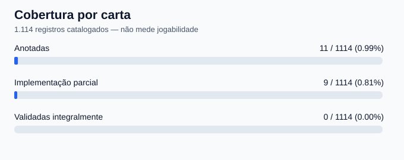

# Progresso da reimplementação



Snapshot auditado no commit `12f560fc1eb270aa0ed28b8cab9982524ea2c5bc`, usando [`p025.annotations.json`](p025.annotations.json). **Não representa porcentagem de cartas jogáveis nem paridade nativa.**

| Indicador | Quantidade | Percentual do catálogo |
| --- | ---: | ---: |
| Cartas catalogadas | 1.114 | 100% |
| Cartas identificadas/anotadas | 11 | 0,99% |
| Cartas com implementação parcial documentada | 9 | 0,81% |
| Cartas com validação integral comprovada | 0 | 0% |

As **nove cartas parcialmente implementadas** incluem cinco magias P045 (Sparks, Hinotama, Final Flame, Ookazi e Raimei), três equipamentos P025 (Legendary Sword, Beast Fangs e Sword of Dark Destruction) e Axe Raider (cálculo de atributos da IA). A oitava família de efeito ou a nona carta não deve ser inferida automaticamente: **Infinite Cards** é um comportamento legado no demo fora deste registro auditado.

| Dimensão independente | Quantidade |
| --- | ---: |
| Mecânicas com anotação (inclusive candidatas) | 9 |
| Vínculos carta–mecânica | 27 |
| Inventários de carta marcados Open | 1.114 |

O catálogo tem 1.114 registros internos não sentinela, mas o conjunto de cartas dos jogos é menor, com versões sobrepostas. Todos os estados de validação da **carta inteira** permanecem `Unknown`. Teste sintético ou uma observação parcial do original não deve promover automaticamente a cobertura.

## Cartas anotadas

| Carta | Escopo de implementação |
| --- | --- |
| Axe Raider | Partial — atributos de IA |
| Legendary Sword | Partial — equipamento P025 |
| Beast Fangs | Partial — equipamento P025 |
| Sword of Dark Destruction | Partial — equipamento P025 |
| Sparks | Partial — magia P045 |
| Hinotama | Partial — magia P045 |
| Final Flame | Partial — magia P045 |
| Ookazi | Partial — magia P045 |
| Raimei | Partial — magia P045 |
| Witch of the Black Forest | Unknown — candidata de pesquisa |
| Zombyra the Dark | Unknown — candidata de pesquisa |

## Atualizar este painel

Este snapshot foi calculado a partir do [relatório de integração](integration-report.md). Para reconstruir os arquivos `progress.md` e `progress.svg` do **registry completo gerado localmente**, execute na raiz do repositório, usando o PowerShell:

```powershell
dotnet build .\src\Joey.Coverage
python .\scripts\generate_card_coverage.py `
  --dat ..\passion\data.dat `
  --exe ..\passion\joey_pc.exe `
  --output .\scratch\coverage-current `
  --baseline-commit 12f560fc1eb270aa0ed28b8cab9982524ea2c5bc `
  --annotations .\docs\coverage\p025.annotations.json `
  --coverage-report --investigation-priorities

python .\scripts\render_coverage_progress.py `
  --registry .\scratch\coverage-current\registry.json `
  --output .\scratch\coverage-dashboard
```

A saída em `scratch/coverage-dashboard` é um artefato gerado, não a fonte de verdade. Confira os valores contra o registry antes de atualizar arquivos versionados. O gerador é somente leitura para o jogo, não executa EXE nem hooks.

Documentação: [registry e critérios](integration-report.md), [gerador](generator.md), [observação real parcial de Sparks](../evidence/sparks-2026-11-14-passive-observation.md).
