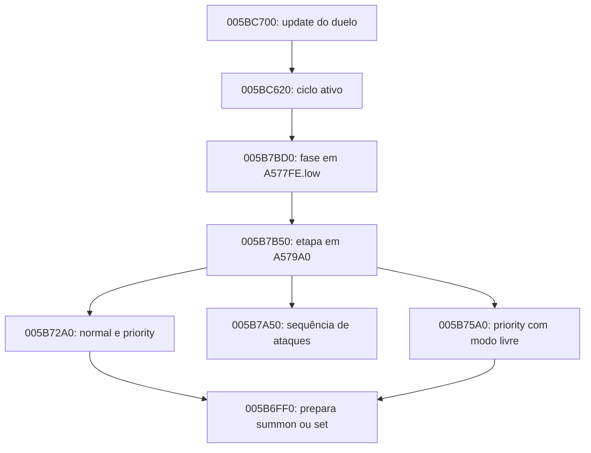

# Motor de decisões da CPU — Joey the Passion

## Escopo, fontes e grau de conclusão

Investigação estática no Fedora, Ghidra 12.2, projeto existente, consultas
`-process joey_pc.exe -noanalysis -readOnly`. Funções criadas por `tempfunc:`
existem só dentro da transação revertida do script. Nenhum jogo, helper
nativo, save, DAT ou patch foi executado/alterado nesta investigação.

EXE SHA256 `db8fe7b7ea4b12f18a9bb1777b5f5b8eab254011db2a52571a0264725505b6de`;
DAT `7e8841ceb015861dacf898d4a62a909e399da14bb7d69c40de3afa3a4610e1ed`.
Todos os endereços abaixo são **VA**, base 00400000. Índices internos,
IDs de recurso e posições da mão são identificadores distintos.

**Resultado:** reconstruídos o comparador final normal, a política de passes
do caller, as três políticas de prioridade, o acumulador/seleção de confrontos,
o dispatcher de etapas e o contrato limitado de rollback. A escolha550 foi
correlacionada à execução real e ganhou uma explicação estática plausível,
mas **a decisão completa ainda não foi reproduzida**: faltam métricas/gates
por candidato naquela captura. O novo teste Windows detalhado
(`commands-20261111-034109-625866-pid29768.jsonl`) mudou **o alcance
da validação do comparador**: três candidatos simulados tiveram seus
ATK, score, máscara e AA registrados e o ranking C# reproduziu as
três aceitações/rejeições, além dos índices retornados por duas chamadas
nativas. Os filtros que descartam cartas antes da simulação seguem
pendentes, portanto isso **não é** reprodução da decisão integral
a partir do estado inicial. [Evidência nova](../evidence/ai-detail-ranking-live-validation-2026-11-11.md).
Não implementar efeitos ou IA faltantes por aproximação.

Legenda: **E**=comprovado estaticamente para o EXE fixado; **O**=observado
na captura identificada; **I**=inferência condicionada; **H**=hipótese aberta.
Confiança alta num trecho estático não significa validação dinâmica integral.

Relatórios primários novos, preservados para auditoria:

| Referência | Conteúdo |
| --- | --- |
| [S1](../evidence/ai-decision-selectors-deep.txt) | Seletores, comparator, baseline, backup/restore, preparação e máximo próprio. |
| [S2](../evidence/ai-decision-combat-deep.txt) | Score, ordenação, alvo/evento, filtros e atributos próprios/ocultos. |
| [S3](../evidence/ai-decision-control-flow.txt) | Assembly dos passes, gate final, soma assinada e política de tributos. |
| [S4](../evidence/ai-decision-dispatch-and-scratch.txt) | Callers 005B72A0/75A0, slots, filtros e cálculo de atributos. |
| [S5](../evidence/ai-decision-outer-dispatch.txt) | Tabela externa, dispatcher, filtros de ataque/colocação e inicialização. |
| [S6](../evidence/ai-decision-dispatch-table.txt) | Dispatcher 005B7B50, ataque 005B7A50, branchGoblin e modos. |
| [S7](../evidence/ai-decision-phase-router.txt) | Feedback fora do restore, elegibilidade e custos. |
| [S8](../evidence/ai-decision-native-phase-tables.txt) | Update principal e postura; ABI do predicado de tributos. |
| [S9](../evidence/ai-decision-turn-phase-dispatch.txt) | Dispatcher de fase e tabelas, mais offsets do candidato. |
| [D1](../evidence/normal-duel-lp-ai-live-validation-2026-11-11.md) | Captura normal inteira, LP reais e12 correlações CPU → CE. |
| [D2](../evidence/ai-detail-ranking-live-validation-2026-11-11.md) | Duas decisões normais com baseline, máscara, score e três avaliações nativas reproduzidas pelo ranking C#. |

Os seis documentos de entrada permanecem como histórico; correções abaixo
prevalecem sobre seus esboços incompletos, especialmente “sempre passe0→-1”.

## 1. Fluxo de controle: seleção não é execução

### 1.1 Etapas e subestados

**E/S5–S6:** `005B7B50` consulta `005EFB50[byte(A579A0)]`. A flag
`playerFlags & 0x800000` ou um ponteiro nulo encerram essa sequência.
Retorno0 da etapa mantém o estágio; retorno não zero zera os bytes de
subestadoA579A1/A579A2 e incrementa o estágioA579A0. Não interpretar0/1
dessas funções como “carta inválida/válida”: são sinais do escalonador.

| Estágio em A579A0 | Função da tabela | Papel demonstrado nesta pesquisa |
| ---: | --- | --- |
| 0 | 005B6E10 | Etapa anterior; política completa fora do escopo atual. |
| 1 | 005B62F0 | Etapa anterior; política completa fora do escopo atual. |
| 2 | 005B72A0 | Seleção normal e primeira rota de priority. |
| 3 | 005B76C0 | Etapa intermediária; não nomeada semanticamente. |
| 4 | 005B7A50 | Seleção de confronto e processamento da fase de ataques. |
| 5 | 005B75A0 | Outra rota de priority, aceitando summon ou set. |
| 6 | 005B7960 | Etapa posterior. |
| 7 | 005B69D0 | Etapa posterior. |
| 8 | nulo | Termina a sequência. |

`005B72A0` usa `byte(A579A2)` como subestado 0..4. Caso0 tenta `normal`;
caso1 reavalia baseline; casos2/3 chamam 005B6690/005B6630 e podem reiniciar
seu subestado; caso4 tenta `priority`, mas só executa se 005AE270 devolver0.
A etapa5/005B75A0 tenta `priority` novamente e aceita o modo devolvido por
005AE270. Isso explica estruturalmente por que podem existir duas escolhas
iguais de priority antes de um CE, sem provar o percurso de cada captura.

O update 005BC700 é outro nível: despacha por
`005EFBB0[(word(A577FC)>>8)]` (005B9F50,005BC620,005BC3C0), com gates de
filas/UI. Não confundir esse índice com estágioA579A0 ou subestadoA579A2.
S8–S9 fecham o caminho intermediário: `005BC620` chama `005B7BD0`, que
consulta `005EFB78[byte(A577FE)]`; entrada 3 dessa tabela é `005B7B50`.
Quando os dois bytes baixos de A577FE estão zerados, `005B7BD0` inicializa
A579A0..A57F53 com zero (0x5B4 bytes), incluindo os buffers de avaliação.
Retorno não zero de uma fase incrementa A577FE.low e zera seu byte alto.



Setas representam caminhos estáticos com gates omitidos, não todas as
chamadas de um frame. As ações reais continuam passando pelo executor 005B6FF0 e builder 005AD740;
CE marca preparação, não prova sozinho que a invocação terminou.

### 1.2 Política real de passes — correção nova

**E/S3,005B7354..005B73BA:** após gates de duelo ativo, invocação não
consumida (`0x20000`),005AE390,00570A70/00570AC0 e recurso adversário015B:

```text
side = byte[A577FA] & 1
specialTribute = AE9C0(side, excluded=-1, mode=1)
if specialTribute >= 0:
    handIndex = B1360(side, pass=1)         # CALL005B739D
    if handIndex == -1: handIndex = B1360(side,-1)
else:
    outerBaseline = B08B0(side)            # CALL005B7385
    if outerBaseline != 0:
        handIndex = B1360(side, pass=0)     # CALL005B739D
        if handIndex == -1: handIndex = B1360(side,-1)
    else:
        handIndex = B1360(side, pass=-1)    # CALL005B73B5
if handIndex >= 0:
    B6FF0(side, handIndex, modeSelector=0) # CALL005B73D2
# falha/etapa concluída atualiza o subestado; não há chamada recursiva de priority
```

Dentro de 005B1360: níveis1..4 aceitam `pass!=1`; níveis5..6 e os demais
ramos aceitam `pass!=0`, com tributos. Portanto1 restringe a tributos,0 evita
tributos e-1 permite ambos. São valores do parâmetro, não níveis de dificuldade.
O caller pode calcular baseline antes e o seletor calcula seu próprio baseline
outra vez. Valores desses dois momentos não devem ser equiparados sem captura.

AE9C0 é uma busca ordenada por referências de tributo, não contagem genérica:
procura referências no adversário sob 005AECB0, monstros próprios com vínculo
0403, casos002F/023D e vínculos060C/02DF/058B/04DC/015C; modo0 permite
mais um ramo de monstro fraco. AECE0 prioriza essa busca; no fallbackAED60
exige ATK do tributo menor que ATK base do candidato. Referência é um WORD
com bytebaixo=side e bytealto=slot. Não concluir “há monstro no campo, então
há tributo elegível”. AECB0 devolve EAX de6A0D0/6A140 apesar do `void`
inferido pelo Ghidra (assembly emS8).

## 2. FUN005B1360 — seletor normal completo no nível dos helpers

**E/S1,S3.** Cdecl `(uint side,int pass)`; EAX é índice zero-based da mão
ou-1. Não devolve índice da carta/ID do recurso, score ou slot do campo.
Mão: DWORDsA56434+side*D44, quantidade byteA55D68+side*D44.

```text
Normal(side, pass):
    bestIndex = -1
    bestScore = B08B0(side)                # snapshot→prepare→score→restore
    bestOpponentLosses = (word[A579AA] >> 3) & 7
    for handIndex in 0 .. handCount(side)-1:
        card = handWord(side,handIndex) & 0xFFF
        if AAB90(side,card) == 0: continue
        if AE3E0(side,2,ResourceId(card)): continue
        if AE220(card) != 0: continue
        level = 004026C0(card)
        if level in 1..4:
            if pass == 1: continue
            tributes = []
        elif level in [5,6]:
            if pass == 0: continue
            t = AECE0(side,-1,card,0)
            if int16(t) == -1: continue
            tributes = [t]
        else:                              # default nativo, não inventar níveis novos
            if pass == 0: continue
            t0 = AECE0(side,-1,card,0)
            t1 = AECE0(side,t0,card,0)
            if int16(t1) == -1: continue    # teste explícito final; não adicionar guarda nova
            tributes = [t0,t1]

        B08E0(side)
        B09C0(side)
        slot = B1610(side,card,len(tributes),tributes)
        stats = 56DD30(side,slot)           # struct12; +4=ATK
        candidateScore = B0A50(side)
        AA[6..8] = CountMonsters(side) & 7  # 569D50 após remoções simuladas
        AA[9..11] = CountMonsters(1-side) & 7
        B0950(side)                        # AC.lo recebe máscara de ações ANTES do restore

        if stats.attack < 900: continue
        if (word[A579AC] & (1 << slot)) == 0: continue
        opponentLosses = (word[A579AA] >> 3) & 7
        ownSurvivors = (word[A579AA] >> 6) & 7
        if candidateScore > bestScore or (
             candidateScore == bestScore and
             opponentLosses > bestOpponentLosses and ownSurvivors != 0):
            bestIndex = handIndex
            bestScore = candidateScore
            bestOpponentLosses = opponentLosses
    return bestIndex
```

O comparator está em 005B154B..005B15AF: comparação **assinada** de scores,
limiar900 inclusivo, máscara do slot obrigatória. `AA[0..2]` (perdas próprias)
não participa diretamente desse desempate. Também não há desempate final
por ATK maior, menor custo de tributo, DEF ou maior índice da mão. Empate
integral mantém a escolha anterior. O número de rivais sobreviventes é
escrito, mas não lido nesse comparator. A ausência de candidato que melhore o score ou o desempate do
baseline pode legitimamente produzir -1, mesmo havendo invocações legais.

`005B1610` zera registros completos de tributo (`0x90` cada), pede um slot
em 0056A030, insere os12 bits de identidade e transforma posição por
`(position & ~1)|2`. EAX preserva o slot, embora o protótipo Ghidra digavoid.
Não tira cartas da mão nem paga custos reais: é hipótese de campo para o
avaliador. Em 0056A030 a busca é ordenada, com uma primeira passagem especial
quandoA577EC.bit 0 está ativo; não simplificar para “primeiro slot vazio”
sem o predicado 00569F70 e o contextoA57840/A57864/A578F4.

Os dois seletores não contêm uma chamada explícita de RNG para desempatar.
Isso não prova determinismo global: helpers transitivos, ordem da mão, estado
de efeitos e histórico do escalonador ainda são entradas. Nenhum peso aleatório
ou fator de estrelas foi acrescentado à transcrição para preencher essa lacuna.

### Motivos de retorno-1 e limites de legalidade

Podem zerar o conjunto: mão vazia; AAB90; AE3E0; AE220; passe incompatível;
tributos não encontrados; ATK<900; candidato não aparece na máscara da
simulação; score inferior; ou empate sem aumento de perdas rivais/sem
sobrevivente próprio. Os valores por candidato distinguem essas causas.

AAB90 devolve máscara de summon/set, não apenas bool. O seletor aceita
**qualquer retorno não zero**, mas outros ramos/executor podem exigir um
modo específico. Ele usa a identidade mascarada, não o DWORD completo da
mão usado por certos testes antigos. AE220 exclui whitelist 00567620 e
recursos04DB/02DF/0492/0585. AE3E0 é política por recurso/contexto; por exemplo,
modo2 depende de alvos úteis para certos efeitos. Não é sinônimo de legalidade.

## 3. FUN005B16C0 — três políticas diferentes, não um argmax universal

**E/S1,S3–S4.** Cdecl `(uint side)`; EAX=índice da mão ou-1.

### 3.1 Prioridades que retornam imediatamente

Só entram se `AE9C0(side,-1,1)==-1` e `56A000(side)!=0` (zona permitida).
Dentro do bloco, a primeira correspondência retorna o **primeiro exemplar
na mão**, via56D340. Essas saídas **não passam** pela varredura AAB90/AE3E0
subsequente. Não presumir legalidade dessas escolhas ou acrescentar filtros
na transcrição sem separar compatibilidade de correção de regras.

| Ordem | Recurso, nome | Condição adicional |
| ---: | --- | --- |
| 1,2 | 01F4 Man-Eater Bug;021C Hane-Hane | CountMonsters(adversário)>0 |
| 3 | 01AB Magician of Faith | 56A8E0(side,0016)>0 |
| 4 | 0065 Mask of Darkness | 56A8E0(side,0015)>0 |
| 5,6 | 021B Skelengel;024E Morphing Jar | mão própria < 3 OU mão própria + 2<mão rival |
| 7 | 0246 Weather Report | 5699A0(rival,015B)>0 |
| 8 | 0027 Dragon Piper | 5699A0(rival,0148)>0 |
| 9 | 0109 Princess of Tsurugi | 56A320(rival,0,0,1)>1 |
| 10 | 0249 Greenkappa | 56AA50(rival,0)>1 |
| 11 | 00DF Trap Master | 56AA50(rival,0)>0 |
| 12,13 | 048B Morphing Jar#2;0452 Cyber Jar | 5AFE90(side)<0 |

### 3.2 Varredura por força e exceção de tributo

```text
specialTribute = AE9C0(side,-1,1)            # valor obtido na entrada
maxOpponentAttack = max(0, 56F690(1-side,slot) para slot0..4)
threshold = AFFD0(side,side,-1,1,0)          # máximo ATK próprio calculado; -1 se vazio
bestIndex = -1
for cada posição da mão:
    card = hand & 0xFFF
    power = max(BaseAttack(card), BaseDefense(card))
    if !AAB90(side,card) or AE3E0(side,2,ResourceId(card)): continue
    exceptional = specialTribute != -1 and Level(card)>4
    if not ((power > threshold and power >= maxOpponentAttack) or exceptional): continue
    if Level(card)<=4 and 56A000(side)==0: continue
    if AEE70(side,card,0)==0: continue         # viabilidade de tributos; não paga
    bestIndex = handIndex
    threshold = power
if bestIndex >= 0: return bestIndex
```

`power` é base; threshold é ATK próprio **calculado**, não máximo de ATK e
DEF próprios. A leitura do máximo rival56F690 não é a mesma heurística de
informação oculta usada por5ADDC0. A exceção de tributo pode substituir um
candidato mais forte por um mais fraco e abaixa `threshold` ao fazê-lo.
Logo, “sempre pega o maior atributo da mão” também é incorreto para priority.
Sem exceção, comparações estritas mantêm o primeiro empate de power.

### 3.3 Fallback na ordem da mão

Se ainda não encontrou candidato e há zona:
`pressure=B3D30(side)`; devolve primeiro card com `Level<5`, AAB90!=0 e
`AE3E0(side, pressure ? 1 : 2, ResourceId(card))==false`.
B3D30 compara `LP(side) <= B0330(side,rival)-B0330(side,side)`;
B0330 soma os ATKs dos cinco slots, com ADD60 para próprio eADDC0 para rival.
A mudança de modo2→1 relaxa filtros de utilidade de cartas específicas sob
pressão. Esse fallback não testa ATK900, bit AC ou superioridade ao baseline,
nem aplicaAE220. Assim `normal=-1` e `priority>=0` são resultados compatíveis.
O modo final face-up/set vem de AE270/AE0A0 e das regras do executor, separado
da escolha de índice; `-1` interno de AE0A0 é convertido ao fallback do caller.

## 4. Matemática da avaliação de combate

### 4.1 Baseline e hipótese usam o mesmo avaliador

B08B0=`B08E0 → B09C0 → B0A50 → B0950`. B09C0 prepara posições próprias,
permitindo a certas cartas testar postura de ataque sob gates nativos.
Portanto baseline não é mera soma dos ATKs do campo real, mas o resultado
simulado dessa preparação. Não inclui automaticamente o custo da carta da
mão, custos de oportunidade, vitórias futuras ou minimax.

B0A50 zeraAA.bits 0..5 e a máscara de açõesA55D70(side), consultaA0DD0 e
repeteB0B90. A0DD0 exige duelo ativo, ausência deplayerFlags.0x40000 e um
bitmap de participantes emA55D6E. Cada evento escolhido marca seu atacante
na máscara; 56B730 exclui slots já marcados. Sob o contrato de cinco slots,
a avaliação consome no máximo cinco eventos. Remoções alteram identidades
antes da próxima iteração e podem alterar atributos/efeitos consultados.

```text
total = 0
AA &= 0xFFC0
actedMask(side) = 0
if !A0DD0(side): return 0
while B0B90(side) != 0:
    event = read4(A579A6)
    actedMask |= 1 << event.attackerSlot
    if event.flags & 0x0400:
        removeIdentity(side,event.attackerSlot); AA.ownLosses++
    if event.flags & 0x0800:
        removeIdentity(1-side,event.targetSlot); AA.opponentLosses++
    total += int16(event.highWord)            # MOVSX005B0B5E; ADD005B0B66
return total                                # int32, não uint16
```

B0B90 reordena participantes a cada busca por chave crescente
`(priorityClass<<16)|(calculatedATK & 0xFFFF)`; classe1 para recurso05F3,
classe3 para02F9/0226/02E8, classe2 para os demais. Selection sort usa`<`,
mas **não é estável**: swaps podem inverter empates que estavam na mão/campo.
Retorna o primeiro atacante dessa ordem para o qualB0D90 acha evento útil.
É uma política gulosa de uma fase de combate, não busca do melhor conjunto
de permutações de ataques nem árvore de turnos demonstrada.

### 4.2 Evento de quatro bytes e escolha de alvo

| Parte | Significado E |
| --- | --- |
| lowWord bits 4..6 | Slot do atacante0..4. |
| lowWord bits 7..9 | Slot do defensor na rota normal. |
| bit 0002 | Rota especial, alvo numérico5; target bits não são confiáveis nessa rota. |
| bit 0004 | Evento selecionado pelo loopB0B90. |
| bit 0008 | Utilidade do confrontoB0F40. |
| bit 0400/0800 | Remoção hipotética própria/adversária. |
| highWord | Score **int16**; não um comandoYDR ou damagepacket. |

B0D90 tenta primeiro a rota especial sob56BF20/56BFD0; ela consultaB05A0
comtarget5, armazenaATK nos16 bits e só retorna sucesso seint16(ATK)>0.
Os predicados são compatíveis com ataque direto; validar a rota em captura
continua útil antes de usar “dano direto” como equivalência universal.

Na rota comum, percorre alvos 0..4; exige56BD80 eB05A0, geraB0F40 e ignora
eventossem bit 8. Melhor scoreint16 vence. Em empate, **novo alvo oculto
substitui incondicionalmente**; novo alvo visível substitui só se suaDEF
calculada for maior que a do melhor anterior. A checagem de visibilidade
é do novo alvo, não necessariamente de ambos. A ordem pode afetar resultado.

### 4.3 Fórmula e exceções emB0F40

Atributos de12bytes: índiceuint16,type byte,attribute byte,ATK int32,DEF int32.
ADD60 calcula o próprio monstro como revelado temporariamente e restaura
esse bit. ADDC0 calcula o rival revelado normalmente; se oculto, usa
ATK=DEF1000 para Level<=4 ou1900 para Level>4, com identidade/tipo/atributo
zerados no buffer. Isso não prova ausência de leitura de informação oculta
em todas as outras rotinas, sobretudo o máximo rival depriority.

Seja`a=ATK atacante após modificadores locais`, `v=ATK rival se ataque,
senãoDEF rival`. Antes dasexceções:

| Comparação | Alvo em ataque | Alvo em defesa |
| --- | --- | --- |
| a>v | remove rival; ganho=a−v | remove rival; ganho/perda0, salvo perfuração/reflexo |
| a==v | ambos removidos só se a>0;score 0 | ninguém removido;score 0 |
| a<v | remove atacante;perda=v−a | ninguém removido;perda=v−a |

Score final=`int16(uint16(ganho)-uint16(perda))`. A utilidade é
`score>0 OR (removeRival AND NOT removeAtacante)`. Assim matar um defensor
sem dano pode ser útil com score 0; uma troca mútua de ATK igual/score 0 não é
útil pelo predicado. O score não é um bônus fixo por matar, pois a preferência
por remoção sem ganho aparece separadamente na utilidade/desempate.

A fórmula inclui, antes/depois dessa tabela, modificadores de recursos e
vínculos:01DD (+1000 contra tipo 6),04E5 (+2000 contra tipo 15),011F (metade
arredondada de DEF contra tipo 1),0291 (Metalmorph: contagem×metade do ATK
rival), perfuração por053D/0521/0604 e lado de origem do vínculo. Flag de
jogador0x400000 remove a perda/removal correspondente;058F comgate014D
pode zerar contribuição de dano.0199 força remoção do rival deatributo2;
04CF remove perda própria e força contribuição500 contra ataque ou0 contra
defesa;04E3 remove perda própria seATK rival>=1900. Preservar a ordem exata
emS2 para futura transcrição, pois exceções posteriores podem substituir
flags calculadas anteriormente. Não generalizar esses exemplos a efeitos
completos das cartas, que têm outros callbacks.

A função 005BE050 é`(value*5+5)/10` com divisão inteira truncada; só para
não negativos sem overflow equivale aceil(value/2). Flags16bits e aritmética
assinada precisam ser explícitas no C#, sem promoções/overflow acidentais.

### 4.4 Score intermediário não é score total

O probe atual capturaB0F40, que produz **propostas de confronto com alvos**,
inclusive inúteis ou descartadas. B0D90 pode escolher outra proposta e
B0B90 pode escolher outro atacante. Não somar todos os22 `combat_event` do
JSONL como se fossem eventos consumidos porB0A50. É necessário observar a
saída escolhida de B0B90 e o retorno de B0A50.

Além disso, a última chamadaB0B90 que retorna0 zeraA579A8 e limpa bits do
descritor global. LerA579A6/A8 apenas depois do avaliador não reconstrói o
último evento significativo nem a sequência somada.

## 5. Snapshot, restauração e efeitos persistentes

**E/S1–S4,S7.** Não há transação completa do duelo:

| Região/valor | Comportamento e estado após restore |
| --- | --- |
| A55D74..A56043 eA56AB8..A56D87 | Cinco registros0x90 por lado; salvos emA579B4 eA57C84 e restaurados byte a byte. |
| A55D6E+side*D44 | Bitmapaux; salvo emA579AE e restaurado. |
| A55D70+side*D44 | Máscara de ações; salvo emA579B0 e restaurado. |
| A579AC.low16 | Recebe **máscara simulada antes** de restaurarA55D70; saída intencional usada pelo seletor. |
| A579AA | Contadores de perdas e sobreviventes permanecem; apenas bits 0..5 são resetados ao entrarB0A50. |
| A579A6/A8 | Descritor/scratch do último loop, normalmente já limpo na tentativa final sem evento; não restaurado. |
| A579AE/B0 e backupsA579B4..A57F53 | Mantêm o último backup; buffers globais compartilhados. |
| 005EBEE4 | Feedback escrito por 0045E240, chamado em AAB90/B7D0/56B5A0; **não é restaurado** pelo snapshot. |
| Mão, LP, deck, filas, RNG | Não cobertos pelo backup. Nenhum débito real de mão/LP foi localizado no núcleoB1610/B0A50; isso não prova isolamento transitivo de todos os helpers. |

AA[0..2]=perdas próprias;[3..5]=perdas rivais;[6..8]=sobreviventes próprios;
[9..11]=sobreviventes rivais. Osdois últimos são escritos pelo seletor depois
do score, não pelo baseline. Não tratar AA inteiro como uma saída nova de
baseline: seus campos altos podem conter resultado anterior.

As exclusões de identidade e a preparação de posição são revertidas; os
resultados métricos são preservados de propósito. Isso não constitui, por
si, corrupção do duelo. Já 005EBEE4 demonstra um efeito fora da transação
que uma invocação avulsa desses helpers pode deixar mesmo após rollback.
Reentrância não é suportada por dois buffers globais sem pilha de snapshots;
nenhuma proteção de reentrância foi comprovada. Futuro port deve usar cópias
locais/contexto de avaliação e distinguir resultados de efeitos colaterais.

## 6. Caso real: evento 26 → CE30

Captura original não versionada:
`scratch/traces/commands-20261111-022940-355228-pid36348.jsonl`, SHA256
`dd2029e8397d22401b7790ce3f007c9353cef94d5e6a9c14dbe1690d20206a90`.
1120eventos sem gaps/overwrite;13normal,10priority,12CE_CPU correlacionados.
`metadata.exeSha256` é null: o fingerprint do EXE vem da documentação da
captura, não de um campo automaticamente atestado pelo JSONL.

**O:** enter10/call1597/thread 27920/side 0/pass-1/caller 005B73BA;
leave26 retornahandIndex5, selectedCardIndexAtEntry550. CE30 na mesma
thread temsource550, handIndexCandidate5, fieldSlotCandidate0,stage 37.

| Mão no enter10 | Identidade estática no DAT | Evidência computada durante a chamada |
| ---: | --- | --- |
| 0:894 | Magic Cylinder,04BE | Carta na mão; não demonstra jogada legal. |
| 1:359 | Monster Reborn,03F0 | Idem; não inferir alvo de cemitério. |
| 2:893 | Magic Jammer,0405 | Idem. |
| 3:307 | Goblin Attack Force,0540 | stats11..14:ATK2300/DEF0. |
| 4:364 | Panther Warrior,02E8 | stats16..17:ATK2000/DEF1600. |
| 5:550 | Gemini Elf,0213 | stats18..23:ATK1900/DEF900. |

Adversário:stats15/24,índice 24=Axe Raider/004D,ATK1700/DEF1150.
Evento25=`0808C800`: attacker0,target0,removeRival=true,removeAtacante=false,
score +200,útil. A conta1900−1700 é compatível com essa saída. CE30 entrega
a mesma carta ao construtor; dano realseq43=200 foi confirmado por LP[D1].
Essas correspondências não dizem quais gates das outras cartas passaram.

**I nova, verificável:**B05A0 trataGoblin0540 especialmente: rejeita alvo
oculto, alvo em ataque com ATK<1900 ou alvo em defesa com DEF<2000. Os valores
capturados de AxeRaider estão abaixo dos dois limiares. Panther02E8 tem gate de
custo em56B7D0/56A290 e, emB05A0(mode!=0), exige algum monstro próprio
ocupado com ATK menor que seuATK. Esses filtros dão uma explicação concreta
para550 superar cartas numericamente mais fortes. Falta confirmar por
telemetria se foram os branches efetivamente tomados em cada hipótese e o
restante do estado a que se aplicaram. Não declarar a causa comprovada.

**O:** todas as13 chamadas normal registradas têmcaller 005B73BA/pass-1;
não houvepass0 ou1 no JSONL. **I:** sob o caller estático exato, cada-1 pode
vir debaseline externo0 ou de um primeiro passe1/0 que falhou. Como esses
primeiros passes não aparecem na janela contínua desta captura, a rota
baseline externo0 é a explicação consistente com instrumentação completa.
Ainda assim baseline externo0 não é uma medida capturada nem prova que o
baseline interno repetido tenha sido0; registrar ambos na próxima captura.

Para `normal=-1→priority`, o auditor confirma as ocorrências e callers
005B74E0/005B7623. A presença depriority não prova um fallback direto no
mesmo frame; pode haver transições de subestado/etapas entre eles.

## 7. Experimentos mínimos para fechar a decisão

Somente **observação passiva de chamadas que o jogo realiza naturalmente**,
processo iniciado manualmente,attach`--observe-only`. Não chamar AIcheck,
seletores, gates, builders, getters nativos ou rollback pelo probe. Não
instalar novos hooks no interior de funções como primeira opção: a pesquisa
anterior documentou crashes desses pontos. Para valores apenas em
registradores/stack internos, usar breakpoints de debugger no Windows em
uma sessão separada, ou derivá-los de entradas/saídas de helpers naturais.

| Pergunta | Ponto/momento e dados mínimos |
| --- | --- |
| Qual candidato passou qual gate? | Enter/leaveAAB90,AE3E0,AE220,AECE0/AEE70; argumentos, retorno,caller,thread,ID do seletor ativo. EnterB1360 preserva mão inteira,pass,perfil de campo. |
| Qual hipótese foi criada? | Enter/leaveB1610:side,card,tributeCount,pares side/slot eEAXslot; não restaurar nada pelo probe. |
| Qual baseline foi usado? | LeaveB08B0:returnEAX eAA,AC; caller 738A=externo,1377=interno. Registrar as duas chamadas mesmo que retornem0. |
| Como chegou ao score? | LeaveB0B90 quandoEAX!=0:descritor de 4 bytesA579A6; leaveB0A50:EAX,total,AA,wordA55D70(side); correlacionar escopo baseline/candidato. |
| Qual alvo foi descartado? | Enter/leaveB05A0,B0D90; argumentos,retorno eout4bytes de B0D90 só quando válido. B0F40 sozinho não basta. |
| Qual máscara sobrou? | EnterB0950:wordA55D70(side); leaveB0950:AC.low16,AA. Captura antes e depois distingue saída de rollback. |
| Qual foi o desempate? | Preferir reconstruir com métricas acima; debugger em 005B154B: EAXATK,EDI slot,EBPscore,[ESP+18]bestScore,[ESP+1C]bestOpponentLosses,[ESP+10]handIndex,[ESP+24]bestIndex,AA eAC. Offsets valem **após**ADDESP34 de1548. |
| Por que priority foi chamada duasvezes? | Enter/leave72A0,75A0,7B50:bytesA579A0..A579A3,byteA577FA,playerFlagsA56430+side*D44,retorno; AE270retorno antes do B6FF0. |
| Rollback cobre as regiões prometidas? | EmB08E0enter eB0950leave, hashes/diffs das duasáreas0x2D0 ewords6E/70; acompanhar 005EBEE4 separadamente. Sem escrever bytes para “corrigir” diferenças. |

Falsificadores: gate observado diferente do ramo previsto para mesmosinputs;
score agregado diferente da soma dos**eventos escolhidos**; comparator diverge
com ATK/mask/score/AA/best coletados; ou bytes de monstros/words não restaurados
na mesma thread sem ação interveniente. Diferença só emscratchAA/AC/feedback
esperado não é falha do rollback. Não executar ensaios volumosos antes do
primeiro caso íntegro e auditado.

## 8. Arquitetura C# proposta e limite implementado

Proposta de projeto, não descrição de classes nativas:

- `AiObservation`: snapshot de campo/mão/LP/regras e visibilidade, com
  provenance/captureID. Não tomar um snapshot durante hipótese como campo real.
- `AiEvaluationContext`: cópias locais de registros,backups e métricas;
  simulação isolada do estado efetivo. Nenhum singleton global equivalente
  aA579B4. Resultado inclui score,perdas,sobreviventes,actedMask e eventos.
- `CombatStatProvider`: cálculo comprovado e políticaOwn/ObservedOpponent;
  separar pressupostos1000/1900 de regras reais de dano e de getters exatos.
- `CombatEventEvaluator` e `GreedyCombatSequence`: efeitos/transições só
  quando especificados; tratar recursos não implementados como indisponíveis
  para reprodução, sem inventar score 0 ou efeito vazio.
- `NormalCandidateFilter` / `PriorityPolicy`: regras,passes e critérios
  distintos. GateLegal e GatePolicy têm causas de rejeição separadas.
- `DecisionScheduler`: estágio/subestado,ação planejada e execução em fases
  distintas; retomar o estado só após eventos de resolução demonstrados.
- `DecisionComparison`: confronta um caso capturado com todas as métricas;
  resultadosmatch/mismatch/incomplete e primeira divergência causal.

Implementado agora apenas [NativeAiRanking](../../src/Joey.Core/NativeAiRanking.cs),
função pura do gate 005B154B..15AF, recebendo métricas **já calculadas**.
Não seleciona cartas, não calcula legalidade/efeitos nem se liga ao demo/IA.
25344 combinações são confrontadas com um oráculo independente de branches
do assembly em[AiRankingChecks](../../src/tests/Joey.Tests/AiRankingChecks.cs).
Essa concordância estática não substitui capturar as entradas desse comparator
no evento 26. O restante acima permanece proposta até haver dados completos.

## 9. Tabela de funções/estruturas e confiança

| VA | Contrato relevante | Confiança / fronteira |
| --- | --- | --- |
| 005B1360 | Normal(side,pass)→handIndex/-1 | AltaE; decisão26 parcialO. |
| 005B16C0 | Priority(side)→handIndex/-1 | AltaE; retornosO, gates não capturados. |
| 005B72A0/005B75A0 | Callers por subestado e modo | AltaE; callersO. |
| 005B7B50/005EFB50 | Dispatcher de etapas e tabela | AltaE; estágios específicos não no JSONL. |
| 005BC700/005EFBB0 | Update e tabela de ciclo do duelo | AltaE para dispatch; regrasUI completas não estudadas. |
| 005B08B0 | Baseline com o mesmo avaliador | AltaE; valores faltamO. |
| 005B08E0/005B0950 | Backup/restore de dois campos + dois words | AltaE limitada àsregiões; integridade dinâmica pendente. |
| 005B09C0/005B1610 | Prepara posições e hipótese/tributos | AltaE; ABI slotEAX confirmada porassembly. |
| 005B0A50 | Soma int16 deeventosescolhidos e máscaras | AltaE; total não observado. |
| 005B0B90/005B0D90 | Ordem de atacantes/seleção de alvo | AltaE; propostasF40 não equivalem a escolhidos. |
| 005B0F40 | Descritor e score com exceções | AltaE;22buffersO validados no layout/utilidade. |
| 005B05A0/0056B7D0 | Política deataque e custos | AltaE nos branchesconsultados; causa26=I. |
| 005ADD60/005ADDC0 | Atributos próprios/ocultos | AltaE; alcance da política por callsite. |
| 0056DD30 | ComputedStats12bytes,ATK+4,DEF+8 | AltaE/layoutO; todos os efeitos ainda não portados. |
| 005AFFD0/005B0330/005B3D30 | MáximoATK/somaATK/pressãoLP | AltaE; taxas deuso não medidas. |
| 005AE9C0/005AECE0/005AEE70 | Referência/preferência/viabilidade tributos | AltaE comochamadas; regras auxiliares não integralmente transcritas. |
| 005AE270/005AE0A0 | Modo de colocação comfallback | AltaE nos callers; efeitos em diversos recursos permanecem helper. |
| 0045E240/005EBEE4 | Grava feedback que fica fora do restore | AltaE; impacto visual exato não capturado. |
| A55D74 +side*D44 +slot*90 | Registro demonstro | AltaE. |
| A579AA | Perdas/sobreviventes emcampos de 3 bits | AltaE; ler validade porcampo/contexto. |
| A579AC | Low16=actedMask,high16=backup6E | AltaE. |
| A579A6/A8 | Descritor/score int16 globais | AltaE; scratch transitório. |

## 10. Reproduzir a análise offline e continuar

```bash
python3 scripts/ai_decision_trace_audit.py \
  scratch/traces/commands-20261111-022940-355228-pid36348.jsonl \
  --expected-sha256 dd2029e8397d22401b7790ce3f007c9353cef94d5e6a9c14dbe1690d20206a90
python3 -m unittest discover -s tests -p 'test_ai*py' -v
DOTNET_CLI_HOME=/tmp/joey-dotnet NUGET_PACKAGES=/home/diego/.nuget/packages \
  dotnet build YugiRE.sln --no-restore -m:1
DOTNET_CLI_HOME=/tmp/joey-dotnet NUGET_PACKAGES=/home/diego/.nuget/packages \
  dotnet run --project src/tests/Joey.Tests --no-build -- ../passion/data.dat ../passion/deck.ydc
```

O auditor é somente leitor de JSONL: valida sequência/metadata, emparelha
callId/thread, confere índice contra mão de entrada e decodifica buffers.
Informa correlação temporal por lado/thread, não reprodução de decisões.
Uma seleção antiga pode permanecer a última válida; proximidade sem ID
causal de execução não fecha todos oscenários de cancelamento/reordenação.
Erros de leitura ficam explícitos no relatório e não são entradas inventadas.

[Fixture reduzido](../../src/tests/Joey.Tests/Fixtures/ai-live-combat-events.json)
preserva22 propostas de combate e2 stats do evento 25 com SHA do JSONL original.
[Testes](../../tests/test_ai_live_combat_math.py) confirmam signedscore,
utilidade,slots e1900−1700=200; quando o JSONL existe, conferem igualdade das
linhas com o original. O fixture não contém baseline/mask/gates e não deve
ser usado como um oráculo completo de seleção.

Lacunas priorizadas: fechar uma decisão combaseline/gates/score/mask; auditar
rollback em captura; medir os branches depriority; validar rotaespecial5 e
casos deempate/oculto/tributos; só depois portar cálculo deefeitos faltante.
O algoritmo não fica totalmente validado porque12 cartas coincidiram com CE.
Estado operacional e próximos endereços: [checkpoint](ai-decision-engine-checkpoint.md).
