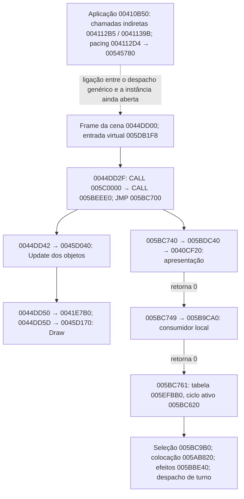

# Scheduler nativo de ações do Joey

Alvo: `joey_pc.exe`, image base `00400000`, SHA-256
`db8fe7b7ea4b12f18a9bb1777b5f5b8eab254011db2a52571a0264725505b6de`.
Ghidra headless com `-noanalysis -readOnly`, conferência de instruções com
`objdump` e leitura das tabelas no PE. Os endereços são VAs. Não houve nova
execução do Joey. Traces anteriores são identificados como observação.

## Laços e pontos de retomada

**Resultado estático:** na cena do duelo, a engine corre antes de Update/Draw
dos objetos visuais. O dispatcher local tem um gate de apresentação anterior
à fila e a fila possui um segundo gate dentro de cada comando ativo. A cena
continua atualizando e desenhando enquanto esses gates impedem o avanço das
regras.



- O construtor `0044C3E0`, chamado pelo factory `00483500` no site
  `00483680`, instala `005DB1F8` em `0044C6A9`. A tabela começa com
  `0044DD00`. O inicializador `0044D960` grava a instância em `005F3280`
  e inicializa `obj+1314h` com 1. Esse basta para identificar a rotina de
  frame da cena. A resolução da **chamada indireta superior** até essa
  instância permanece aberta. O laço externo de `00410B50` e o wrapper
  `005C0000` são pontos distintos. O `JMP` em `005C0005` deixa o retorno
  de `005BC700` chegar diretamente à cena.
- A ordem principal em `0044DD00` vale quando `obj+14h == 0` e
  `obj+1Ch == 0`. O ramo `1 / 0x100` também chama a engine antes de
  Update/Draw, com máscara 2. Outros estados não entram nesses dois
  caminhos. Os dispatchers filtram objetos ativos e sua máscara. A tabela
  virtual dos objetos examinados usa `+8` para Update e `+0xC` para Draw.
- Em `005BC700`, uma checagem de modo e `0040CA70 / 005AA490` precedem os
  dois gates. A tabela do ciclo usa o byte alto de `A577FC`. Se o handler
  retornar não zero, `005BC78A` zera **somente o byte alto** de
  `A577FE`. As tabelas de turno `005EFB78/005EFB94` abaixo de
  `005BC620` usam o byte **baixo** de `A577FE`. O índice da fase
  exibida ainda não foi ligado de ponta a ponta a essas tabelas.
  [Tabelas de turno](../20-turn-scheduling.md) e
  [despacho da IA](ai-decision-engine.md#11-etapas-e-subestados).

## Produtor, dois recipientes e o comando corrente

| Memória | Tamanho e papel | Escritores / leitores |
| --- | --- | --- |
| `00A550A8 .. 00A558A7` | Buffer ativo, 256 registros de 8 bytes | `005B9170` e `005B9370` anexam. `005B9CA0` retira da frente. |
| `00A558A8` | Contagem `uint16` do buffer ativo | Incrementos `005B92A4` / `005B93DB`, decremento `005B9CFA`. `005A9060` e `005995E0` também consultam. |
| `00A550A0 .. 00A550A7` | Registro corrente, fora do buffer ativo | `005B9CF2` copia para cá pelo helper `005BDE10`. `005B9470` e seus handlers leem aqui. |
| `005F3248` → contêiner | Elementos de 16 bytes. `+4` no wrapper aponta para uma cópia alocada de 8 bytes. Base/fim **no contêiner** em `+8/+0C`, cursor em `+30`. | `00449D50` aloca, copia e anexa por `0044B2A0` em `00449DA3`. Acessores `00449DF0/00449E00/00449E10/00449E20` leem e movem o cursor. |
| `00A5828C .. 00A58293` | Registro de outro caminho de entrada | `005B93F0`, chamado por `005BD2D0`, também registra em `00449D50` e arma `A58260 & 0x80`; esse helper não é um append em `A550A8`. |

O registro tem quatro words little-endian: `+0` traz opcode nos 12 bits
baixos e, nos comandos examinados, lado no bit 15. `+2`, `+4` e `+6`
são argumentos por opcode. Por exemplo, em `CE` o word `+2` identifica o
recurso da carta, e `+4` empacota o índice na mão no byte baixo e dados
de destino e flags no alto. Em `43`, `+2` é magnitude de LP. O produtor normaliza
identidades em alguns opcodes antes de escrever words. O consumidor usa
`opcode & 0xFFF`, consulta o byte na tabela `005B9AEC` indexada por
`opcode - 1` e seleciona o stub na tabela `005B9838`.

```text
005B9170: normaliza quatro words
  ├─ se A54E5C & 180h == 80h, retorna sem gravar
  ├─ se contagem < 256, anexa em A550A8 + contagem*8
  └─ 00449D50 → anexa cópia no contêiner dinâmico, mesmo se o buffer estiver cheio

Modo de reapresentação
  005BC580 → 00449DF0 lê o payload no cursor
           → 005B9370 anexa ao buffer ativo sem chamar 00449D50
           → 00449E00 avança cursor em 16 (sem remover o elemento)

Caminho ativo
  005B9CA0 → copia A550A8[0] para A550A0 → decrementa contagem
           → desloca restantes de i+1 para i → 005B9470
```

O contêiner é também serializável por `0044A3D0`, que inclusive alimenta
`00449D50` ao carregar. A ligação com a reapresentação é uma transferência
examinada. Não se inferiu que toda escrita dinâmica corresponda a uma
partida gravada. Em `005BC580(0)`, o feeder copia até um registro.
Com argumento diferente de zero, pode percorrer vários registros em uma
chamada. O cursor avança mesmo se o buffer estiver cheio, pois `005B9370`
não retorna sucesso para o chamador.
[Estrutura dinâmica](../evidence/command-queue.txt) ·
[Produtor](../evidence/command-queue-entrypoints.txt) ·
[Acervo e feeder](../evidence/command-accessors.txt).

## Como o comando termina

`hi8(00A5780E)` governa o consumidor local. Esse seletor é distinto do
subestado `00A558AC & 0x7F`, usado pelo handler do **comando**.

```mermaid
stateDiagram-v2
    [*] --> Retirar
    Retirar --> Despachar: fila nao vazia, instala registro corrente
    Retirar --> Passagem: fila vazia
    Despachar --> Despachar: handler deixou A558AC bit 14 ligado
    Despachar --> Sincronizar: handler limpou bit 14
    Sincronizar --> Sincronizar: A58260 bit 8 desligado
    Sincronizar --> Retirar: volta a 0; ainda ha registros
    Sincronizar --> Passagem: liberado, sem trabalho adicional
```



- **Estágio 0:** `005B9CA0` retira um registro, arma `A558AC & 0x4000`,
  limpa os 14 bits baixos para iniciar o handler e normalmente arma
  `A58260 & 0x100`. Cai no estágio 1 na mesma chamada.
- **Estágio 1:** `005B9470` processa o registro corrente uma vez. Se
  `0x4000` continuar ativo, retorna ocupado. O próximo despacho usa o
  mesmo registro. Se estiver limpo, pode cair no estágio 2 imediatamente.
- **Estágio 2:** exige `A58260 & 0x100`, então zera o seletor alto.
  Havendo registros, retorna ocupado e o próximo só é retirado em
  outra chamada. No modo de reapresentação há a checagem extra de
  `005BC580(0)`. Com a fila liberada, a fase pode avançar na mesma
  passagem que concluiu o último comando.

Portanto, **no ramo local, no máximo um comando novo por chamada do
consumidor**, que é chamado no máximo uma vez por `005BC700`. Isso não
significa um comando por frame. Há ticks sem retirada e comandos que exigem
múltiplos ticks. A compactação não executa os registros deslocados. Os
ramos de sincronização remota (`005B9BF0`, `005BD2D0`) ficam fora dessa
conclusão. [Assembly e decompilação anteriores do gate](../evidence/duel-command-queue-gate.txt).

Há produção de vários registros na mesma **jogada** e há produção por
**continuação**. Exemplo estático: `005BC620 → 005BBE40 → 005BB720`
pode emitir `B1` no estágio 4, ou chamar o callback em `0059DEB0` no
estágio 6. O callback de Sparks chama `005784E0 → 005B9170` para emitir
`43`. O trabalho fica na fila para outra passagem, sem recursão do
consumidor. Não foi comprovado um append **dentro da chamada de**
`005B9470` para os handlers diretos `CE`, `CF` e `72` examinados.
Janelas de decisão são outra forma de continuação: `005BC9B0` testa o
descritor `A57810/A57814`, e um retorno ocupado precede e impede a
resolução em `005BBE40`. O descarte como custo fornece um exemplo
seguido até a escolha e seu comando `8E`.
[Seleção e custo](../cards/tribute-discard-cost.md).

## Três jogadas seguidas estaticamente

### Invocação normal: CE

1. `005AB820` despacha a colocação ativa pelo descritor em `A5508E`.
   No modo de invocação normal, `005ABD00` pode emitir `57` e pagar
   tributos antes do `CE`. O caminho simples sem tributos emite `CE`.
   Já existe observação de invocação normal com anotação dos words em
   [capturas comparadas](../26-normal-summon-tributes.md).
2. `005B9470 → stub 005B9735 → 004059C0`. O subestado 0 avança para
   1. No **1**, `00570790` retira da mão (região 11), `00568610`
   grava no campo e `0040CDB0` arma bit 0 e modo 3 em `A5506A`,
   com identificador e locais de origem/destino em `A5506C/70/72`.
   O comando avança seu subestado, mas preserva `0x4000`.
3. Antes de chamar novamente a fila, `0040CF20` vê o modo 3 e chama
   `0040D070`. O caminho normal chama `0041D160` no site
   `0040D333`, que entrega o destino a `004189D0`. Essa rotina guarda
   a posição atual e zera `obj+14h`. A mesma cena despacha Update;
   a tabela de carta em `005DA868` liga `+8` a `00418B60`, que soma
   `0x20` ao progresso a cada atualização de deslocamento.
4. `0041D0C0` consulta `obj.vtable[+4]` em dois blocos visuais de
   passo `0x460`. Para a carta, `004188B0` responde ocupado enquanto
   `obj+14h != 0x100` **ou** `obj+18h != 0`. Os oito passos de
   posição podem, portanto, ser seguidos por outras etapas do objeto.
   Ao liberar, o handler visual limpa bit 0. O gate ainda retorna 1
   naquela chamada. A fila retoma na seguinte.
5. No subestado **2**, `004059C0` pode criar um objeto extra
   (`0044EFD0` no ramo indicado); no **3**, testa `vtable[+4]` dos
   objetos do intervalo da cena `[005F3280+132Ch, +1330h)`.
   Limpa `0x4000` quando a lista não acusa ocupação.

### Magia com brilho: CF, a família visual 72/1E e dano 43

- **Estático, colocação:** `CF → 005B973A → 00405CB0`. No subestado 1
  espera objetos da cena, retira da mão com `00570790`, coloca com
  `005686E0` e arma o mesmo gate de movimento `0040CDB0`.
  Subestados 2 e 3 tratam a apresentação subsequente e a confirmação
  de término. O caminho de Field Spell seleciona região de visual 10,
  enquanto a rota comum começa pela região 5.
- **Estático, acionamento do brilho:** `72 → 005B9636 → 00406B20`.
  Subestado 1 espera movimentos de carta por `0041D050`. No 2 também
  espera objetos da cena e, se a instância e a identidade coincidirem,
  usa `00418B50 → 00450260` para criar brilho no local da carta.
  Há ramo com `00450730` para outra apresentação. O subestado 3
  testa `vtable[+4]` da lista antes de limpar `0x4000`.
  `1E → 005B9516 → 0040AA40` também tem um ramo que cria esse brilho.
  Na tabela `005DB2F4`, `00403080` (slot +4) devolve `obj+4`.
  Update `00450590` limpa esse byte no 17º passo; Draw é `004505D0`.
- **Observado, instâncias específicas:** na janela de Burning Land houve
  `CF → 72 … 72 → 43(500)`. Em duas janelas de Raimei, `43(300)`
  seguido da queda de LP apareceu após `CF`. No vídeo com `-speedy`,
  Sparks se move, brilha e só então exibe `-200`. O vídeo não
  identifica o opcode do brilho de Sparks. Essas evidências não
  estabelecem `72` como obrigatório para toda magia nem atribuem
  toda a janela de Burning Land a um único callback.
  [Captura de magias](../evidence/native-multi-spell-cf-windows-first-round-2026-11-17.md) ·
  [Callback de Sparks](../cards/sparks-ookazi.md).

### Ataque com dano, retirada e possível FLIP

- No dispatcher de combate `005A4090` (tabela `005EFA68`, índice
  `A577FB`), o elemento 7, `005A2740`, emite `30 → 31` e, para
  cada marca de destruição do ramo seguido, `3C`. `31` entra em
  `00407A20`, que cria a apresentação via `00413BA0 → 004140B0`
  e testa sua conclusão por `00413B80`. `3C → 00405020` desloca
  o registro físico de 0x90 bytes para `A57864` ou `A578F4` e
  limpa o campo na etapa de retirada.
- No elemento 8, `005A2990`, o subestado seguido chama `00578540`
  e pode emitir `43` para dano real. O stub `005B957B` chama
  `00408470(0)`; nesse caminho, `0047C4F0/0047C560 → 00573FB0`
  aplicam o delta. O elemento 9 trata eventos/pedidos intermediários.
  O elemento 10, `005A31A0 → 00577CF0`, emite `7C` no ramo de
  destino final. `7C → 00405190` usa a cópia; em geral vai para
  região 14. A ordem documenta o ramo, com desvios para fichas e
  efeitos. [Combate e cópias](../22-battle-core.md).
- **FLIP é condicional e tem despacho próprio.** No caminho seguido
  de mudança de face, `00574F70` emite `80 → 00407E60`, que
  alterna a face no ramo examinado. O produtor pode também registrar
  um pedido por `005BA490 → 005BA310`. O callback de Man-Eater Bug
  é chamado mais tarde em `005BB720`, estágio 6. Se encontrar alvo,
  pode emitir `79` pelo caminho `00576B30`; o consumidor
  `00404B40` retira/insere e usa o gate visual via `0040CE10`.
  Ainda falta ligar o chamador de `00574F70` e o pedido a um
  **ataque específico** completo. Não há uma posição universal para
  `80` na sequência acima.
  [Pedido FLIP](../cards/man-eater-flip-activation.md) ·
  [Retirada por efeito](../cards/monster-destruction.md).

## Aplicação à Alpha

`PresentationSequence<T>` no LookAndFeel agenda apenas passos visuais
tipados. A operação de regras já terminou quando o app cria a sequência.
A origem/destino e a identidade de uma carta ativada vêm da ação do app,
inclusive o índice de mão e a zona reportados pela CPU. O app desenha uma
cópia temporária, pois a carta pode já estar no cemitério lógico.

Para uma magia da mão, **Travel → Glow** troca de etapa sem esperar um
timer separado. Travel usa os 8 passos de `00418B60`, o índice de cosseno
e a interpolação x16.16 de `CardTravel`. O cosseno é aproximado, e os
retângulos e a escala são do cliente. Glow usa os 17 passos recuperados em
`00450590` e os três passes de `NativeActivationFrame`. Uma carta
setada já está na zona e inicia em Glow. Classic e Fast usam a cadência
nominal de 30/60 updates/s. Instant não agenda animação. Uma demora de
render pode avançar mais de uma etapa **visual**, mas o scheduler não
chama a engine, a CPU ou o consumidor nativo. A duração das animações
não muda as regras nem o resultado headless.
[Contrato visual](../architecture/native-visual-contract.md).

## Reprodução e limites

- `python3 scripts/validate_native_action_scheduler.py` confere SHA,
  VAs da cena e dos dispatchers, retirada/compactação, predicado de
  conclusão e 12 despachos de opcode. Os validadores de turno e combate
  também conferem as tabelas no PE.
- A sequência C# tem testes determinísticos para a transição Travel → Glow,
  o avanço com sobra de ticks e o encerramento. `Joey.Tests` passou 2.838
  verificações offline e 4.194 com DAT e deck locais. A execução
  `--alpha-headless` terminou no turno 21. A inspeção das animações em
  janela permanece pendente.
- Para rever a decompilação, use
  `bash scripts/run-archive-query.sh scheduler-local.txt ref:005bc700 005bc700 005b9ca0 0044dd00 0040cf20 004059c0 00405cb0 00406b20 0041d0c0 004188b0 005bc580`.
  `QueryArchive.java` limita o relatório a 12 funções. O executável
  permanece fechado. A decompilação usa o banco em modo somente leitura.
- Ainda abertos: ponte indireta superior da aplicação para a cena,
  caminhos remotos, mapa dos nomes de fase, confirmação de quais
  comandos enfileiram outros dentro do próprio handler direto e uma
  captura ponta a ponta do ataque com FLIP. A Alpha não importa esses
  contratos incompletos.
