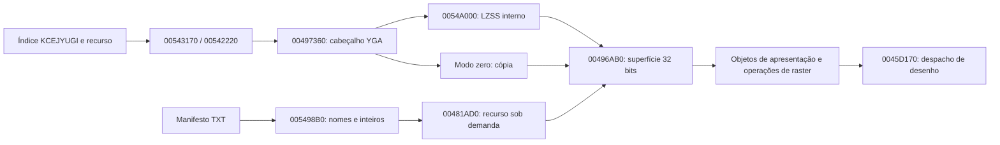

# Arquitetura nativa de apresentação — recorte comprovado

Evidência **estática**, EXE SHA256
`db8fe7b7ea4b12f18a9bb1777b5f5b8eab254011db2a52571a0264725505b6de`.
Todos os endereços são VA, image base `00400000`. Não houve execução no Fedora
nem captura Windows nesta investigação. Os nomes de subsistemas abaixo são
interpretações dos fluxos; não símbolos originais recuperados.

## Do recurso à superfície

O leitor de DAT e sua compressão externa já estavam descritos em
[02-file-formats.md](../../02-file-formats.md). O caminho gráfico `00496CA0`
distingue extensão YGA de outros recursos. `00497360` faz o carregamento direto
YGA; os caminhos BMP passam por outros wrappers e `00497310` limpa o byte alto
dos pixels. Essa limpeza não autoriza usar alpha zero de BMP como transparência
em toda operação: há também caminhos de color key.

`00496AB0` aloca buffer com alinhamento de oito bytes ou cria DIB BI_RGB 32 bits,
altura negativa, stride largura × 4 e tabela de linhas. `00497550` libera DC,
DIB ou heap conforme a origem, libera a tabela de linhas quando é dona dela e
zera campos. [Loader/superfície](evidence/native-yga-loader.txt).

`00481D00` resolve `?` por globais de idioma com fallback antes de chamar o leitor
de manifesto. `00481AD0` cria um wrapper de imagem, concatena o caminho, tenta
variante/fallback e carrega o recurso do slot sob demanda. As linhas do manifesto
mantêm a ordem: ela é usada pelos índices dos controladores. O parâmetro numérico
não é interpretado como coordenada pelo leitor genérico.

## Ciclo compartilhado e ordem de sobreposição

[Evidência: construtor, destrutor, update, comparador e draw](evidence/native-dispatch.txt).

| Campo do objeto base | Semântica sustentada pelo fluxo |
|---|---|
| `+0x00` | Vtable; update em `+8`, desenho em `+0x0C` para os despachantes observados |
| `+0x04` byte | Participação ativa no despacho; construtor inicializa 1 |
| `+0x08` DWORD | Máscara, exige interseção com máscara passada ao despachante |
| `+0x0C` int | Chave de ordenação; comparador subtrai este campo entre dois objetos |
| `+0x10` | Contador de alguns efeitos estudados; não campo universal do base |

`0045CF80` registra o ponteiro no contêiner global **005F3318** por `0045D4F0`.
O destrutor `0045CFE0` remove o objeto desse contêiner; `0045CFC0` também pode
liberar a alocação conforme argumento do destrutor. O contêiner usa comparação
de ponteiros; sua ordem interna não deve ser confundida com a ordem de desenho.

`0045D040(mask)` coleta objetos ativos e com máscara compatível em vetor auxiliar
`005F3304`, ordena por `0045D150` e chama vtable `+8`.
`0045D170(destino,mask)` faz seleção e ordenação equivalentes e chama vtable `+0x0C`.
`0045D150(a,b)` retorna `a->campo_0C - b->campo_0C`.
Assim, a chave é crescente no despacho; o significado de cada faixa e desempate
para chaves iguais permanecem abertos. Não há garantia demonstrada de sort estável.

Os próprios construtores atribuem chaves como `0x110`, `0x120` ou valor derivado
do slot. Isso explica ordenação compartilhada entre classes de efeito, mas não
é um catálogo completo das camadas. Desativar `+4` impede novos despachos;
a liberação depende também dos proprietários/contêineres, não ocorre só por zerar a flag.

## Efeitos e engine de duelo

`00450260` resolve posição a partir do descritor por `0045C140`, consulta categoria
por `00402690`, carrega `activate.txt` e instala vtable `005DB2F4`.
O desenho `004505D0` usa a categoria para escolher o par de recursos. O update
`00450590` controla duração lógica. A [tabela de animações](animation-formats.md)
relaciona os outros efeitos rastreados.

Há uma ponte concreta com a engine: `00406B20`, chamada de `005B9470`, lê
`00A550A0/00A550A4`, converte ID para índice por `00402460` e percorre estados em
`00A558AC & 0x7F`. No estado 2 cria `00450260` quando existe objeto visual
correspondente, ou `00450730` no outro ramo; insere a referência no contêiner em
`005F3280 + 0x132C/0x1330`. Nos estados 2 e 3 consulta virtualmente os objetos
antes de avançar. Há dependência explícita da apresentação para esse fluxo.
Não foi generalizada para todos os efeitos/regras nem rotulada como callback
individual de uma carta sem rastrear o comando produtor.

## Transformações e composição

`00422C00`, usado por ativação e explosão, é um helper compartilhado de desenho
transformado, encaminhando parâmetros de posição, rotação/escala e intensidade
para `00422840/00422E30`. Alguns tipos/argumentos recuperados pelo decompilador
são incertos; os incrementos e limites simples foram separados das fórmulas
cuja pilha não é confiável. Não há port desses pseudocódigos para a aplicação.

As superfícies de raster têm operações de cópia, color key e mistura por CPU:
`0049B800` preserva destino quando pixel fonte coincide com chave `+0x50`;
`0049BA50` copia; `0049BC10/0049BEE0` calculam média de canais;
`0049CD10` contém `psubusb` (subtração saturada). Essas operações não demonstram
qual blend cada YGA usa, nem provam que todo o caminho final de apresentação é
software. O byte A do arquivo não deve ser aplicado uniformemente a todos os
passes sem identificar a operação selecionada pelo wrapper.

A exportação PNG permite inspeção de BGRA/alpha, mas não reproduz o blend,
clipping, rotação, arredondamento nem composição multicamada do original.
Frequência dos updates e interação com apresentação final precisam de outro
rastreamento ou captura Windows; esta etapa não fixa FPS ou milissegundos.

A investigação pausada da mão continua apenas como
[referência](../../visual/duel-hand-pause.md), sem retomada de implementação ou
alteração do layout. O mapeamento de posições também aparece no projeto externo,
mas seus offsets de arquivo não são automaticamente VAs; não foram usados para patches.
